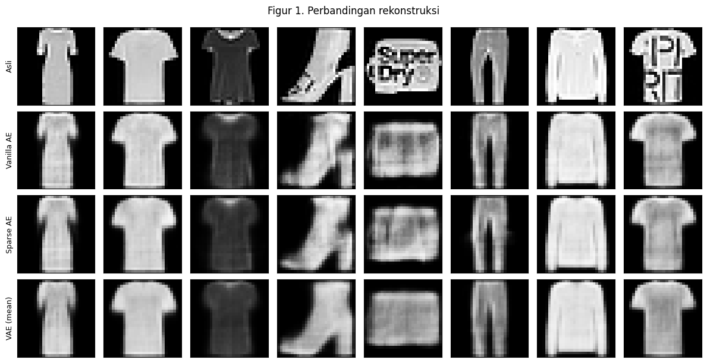
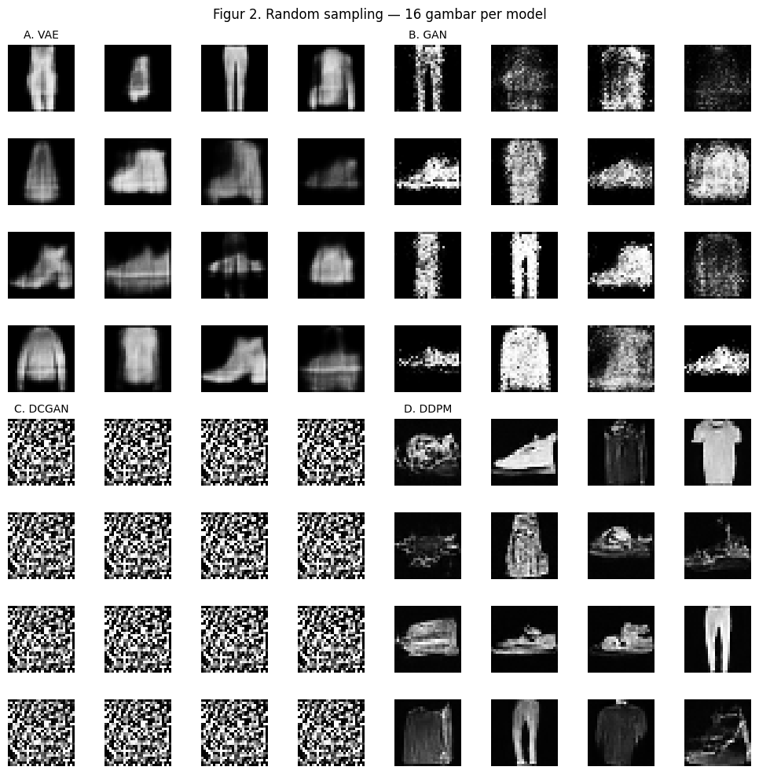

# Studi Komparatif Generative Models

Nama: James Michael Lionel  
NIM: 2802402496  
Mata kuliah: Deep Learning (D6421), Sesi 06–07

Proyek ini membandingkan Vanilla AE, Sparse AE, VAE, GAN, DCGAN, dan DDPM pada Fashion-MNIST.
Eksperimen MLP Classifier digunakan untuk membandingkan hasil transpose bobot, frozen latent decoder,
dan sampling dari statistik fitur laten classifier.

## Isi repository

| Berkas / folder | Isi |
| --- | --- |
| `notebooks/TugasDeepLearning2.ipynb` | Notebook asli dengan output training dan gambar |
| `src/config.py` | Pengaturan eksperimen, termasuk 10 epoch |
| `src/data.py` | Download Fashion-MNIST, split, dan DataLoader |
| `src/models.py` | Enam model generatif, discriminator, classifier, dan decoder |
| `src/training.py` | Training dan validation |
| `src/diffusion.py` | Jadwal noise, forward noise, dan sampling DDPM |
| `src/metrics.py` | MSE, PSNR, SSIM, FID, latency, dan diagnostik MLP |
| `src/figures.py` | Lima figur komparatif dan skema arsitektur, memakai `plt` |
| `src/experiment.py` | Urutan eksperimen, penyimpanan, dan pemuatan bobot |
| `src/utils.py` | Seed, sinkronisasi CUDA, ekspor CSV/JSON |
| `run.py` | Menjalankan skrip modular |
| `requirements.txt` | Dependensi Python |
| `results/notebook_run/` | Hasil dan figur yang sudah tersedia |

## Melihat hasil yang sudah ada

Notebook dan `results/notebook_run/` sudah berisi hasil eksperimen. Tidak perlu training ulang untuk
melihatnya atau mengunggah repository. Asal setiap hasil dijelaskan dalam `results/notebook_run/ASAL_HASIL.md`.
Bobot `.pt` dari runtime Colab tidak termasuk dalam berkas notebook dan tidak disertakan dalam paket.

| Model | Test MSE | Test PSNR (dB) | Test SSIM | FID |
| --- | ---: | ---: | ---: | ---: |
| AE | 0.010238 | 20.772 | 0.7529 | N/A |
| Sparse AE | 0.011582 | 20.221 | 0.7244 | N/A |
| VAE | 0.014721 | 19.081 | 0.6828 | 105.391 |
| GAN | N/A | N/A | N/A | 176.211 |
| DCGAN | N/A | N/A | N/A | 430.084 |
| DDPM | N/A | N/A | N/A | 53.822 |

MLP test accuracy: **88.40%**. Frozen latent decoder: MSE **0.01876**, PSNR **17.938**, SSIM **0.6321**.
Latent transpose: MSE **0.26070**, PSNR **5.894**, SSIM **0.1086**.
Rincian waktu training dan latency terdapat pada `results/notebook_run/metrics.csv`.




## Instalasi

Gunakan Python 3.11 atau 3.12. Jalankan dari folder yang berisi `run.py`:

```bash
python -m pip install -r requirements.txt
```

GPU CUDA membantu mempercepat training dan sampling DDPM. Jika memakai GPU lokal,
pasang pasangan PyTorch/Torchvision yang sesuai dengan sistem melalui https://pytorch.org/get-started/locally/.
Daftar dependensi memakai rentang versi; versi paket runtime Colab asli tidak terekam sehingga bukan environment lock asli.

## Menjalankan ulang eksperimen

```bash
python run.py
```

Perintah ini memulai training baru dengan **10 epoch** untuk setiap model dan decoder, lalu evaluasi serta plotting.
Dataset diunduh otomatis ke `data/`; hasil baru masuk ke `results/new_run/`.
Hasil notebook lama tetap berada di `results/notebook_run/`.
Pengaturan cukup diubah pada `src/config.py`; tidak ada definisi epoch kedua di modul lain.

Untuk melewati FID ketika memeriksa alur:

```bash
python run.py --no-fid --output-dir results/check_run
```

Perintah ini tetap melatih model dan belum menghasilkan evaluasi FID lengkap.
FID lengkap memakai 7.000 gambar nyata dan 7.000 sampel per model. DDPM membutuhkan 1.000 langkah
untuk setiap batch sehingga evaluasi bisa berlangsung lama. Bobot Inception FID diunduh pada penggunaan pertama.

Jika hasil training skrip sudah tersimpan, evaluasi dapat dijalankan tanpa training:

```bash
python run.py --evaluate-only --output-dir results/new_run
```

Untuk mengulang plotting setelah evaluasi tersimpan:

```bash
python run.py --figures-only --output-dir results/new_run
```

Kedua mode membutuhkan bobot seluruh model, `histories.pt`, dan `split_indices.pt` dari run yang sama;
mode plotting juga membutuhkan `evaluation_results.pt`. Snapshot `notebook_run` tidak memiliki checkpoint itu.
Skrip menyimpan bobot setiap model setelah training dan menyimpan evaluasi sebelum membuat gambar.
Jika FID terputus, diagnostik MLP dan metrik yang sudah dihitung tetap ada di `evaluation_partial.pt`.

## Pengaturan eksperimen

- Fashion-MNIST 70.000 gambar digabung dari train/test bawaan, lalu dibagi 56.000 train, 7.000 validation, dan 7.000 test.
- Seed 42, batch size 128, shuffle hanya untuk training, maksimal 10 epoch.
- AE, Sparse AE, VAE, dan MLP memakai representasi laten 64; GAN/DCGAN memakai noise 100.
- Piksel awal 0–1; real input GAN, DCGAN, dan DDPM dipetakan ke -1–1.
- AE memakai MSE. Sparse AE menambahkan 0.0001 × rata-rata L1 norm laten per gambar.
- VAE memakai BCE jumlah piksel per gambar + KL; checkpoint dipilih dari validation loss terbaik seperti notebook.
- AE, Sparse AE, GAN, DCGAN, DDPM, classifier, dan frozen decoder memakai bobot epoch terakhir.
- Metrik rekonstruksi VAE memakai mean laten. PSNR dan SSIM dihitung per gambar lalu dirata-ratakan.
- FID memakai fitur Inception 2048; kanal grayscale diulang menjadi RGB. `torch-fidelity` menangani resize.
- Latency batch 64 diukur setelah 2 warm-up dan dirata-ratakan selama 5 pengulangan, dengan sinkronisasi CUDA.
- Statistik Gaussian laten classifier diambil dari test set sesuai instruksi tugas dan digunakan sebagai diagnostik.
- Endpoint interpolasi GAN/DCGAN dipilih memakai prediksi classifier; prediksi perlu diperiksa secara visual.

## Pengumpulan

Repository harus berstatus publik. Tambahkan PDF laporan final dan cantumkan tautan repository pada halaman judulnya.
Dataset serta checkpoint besar tidak perlu diunggah lewat Git biasa; `.gitignore` mengecualikannya.
Simpan checkpoint sendiri bila ingin menjalankan evaluasi kembali tanpa training.
Catat perubahan berikutnya sebagai commit sesuai pengerjaan yang benar-benar dilakukan.

Pemisahan skrip dan penyusunan dokumentasi dibantu AI berdasarkan notebook. Bantuan ini lebih luas daripada
referensi sintaks/dokumentasi yang diperbolehkan panduan tugas. Pelajari dan tinjau implementasi secara mandiri,
dan pastikan bentuk penggunaan bantuan yang diajukan sesuai ketentuan dosen.

## Referensi

- Fashion-MNIST: https://github.com/zalandoresearch/fashion-mnist
- VAE: https://arxiv.org/abs/1312.6114
- GAN: https://arxiv.org/abs/1406.2661
- DCGAN: https://arxiv.org/abs/1511.06434
- DDPM: https://arxiv.org/abs/2006.11239
- FID: https://arxiv.org/abs/1706.08500
- TorchMetrics FID: https://lightning.ai/docs/torchmetrics/stable/image/frechet_inception_distance.html
